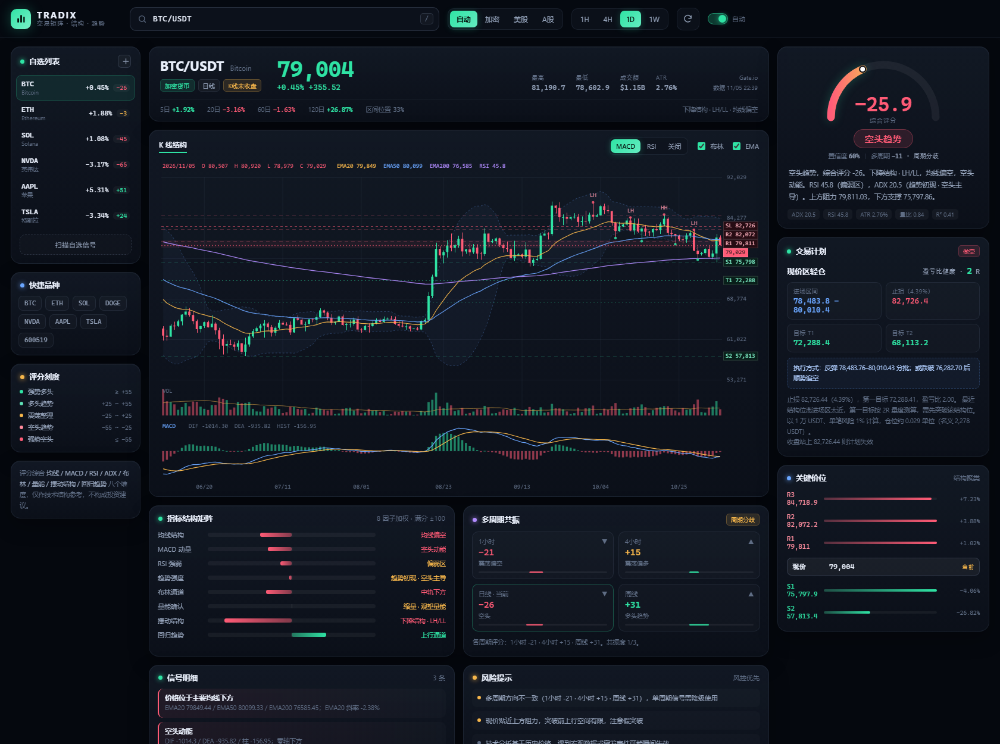
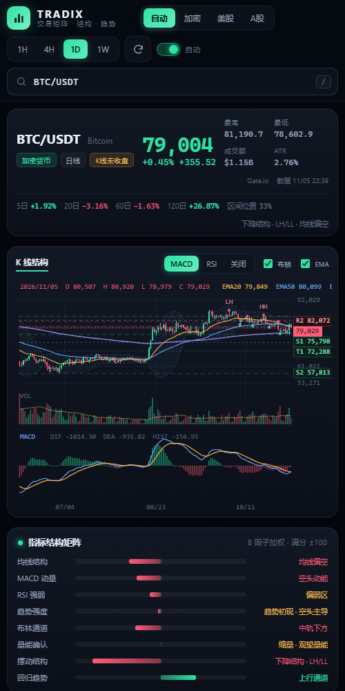

# Tradix · 交易矩阵


**Tradix（交易矩阵）** 是一个本地运行的交易分析工具：输入加密货币 / 美股 / A 股代码，自动拉取行情、计算指标、拆解「指标结构」并给出趋势判定、关键价位与交易计划。

> 面向加密市场与美股，同时兼容 A 股。纯 Python 标准库实现，无需安装任何第三方依赖，不需要 API Key。

<p align="center">
  
</p>
<p align="center">
  
</p>

## 快速开始

**环境要求**：Python 3.10+（Windows / macOS / Linux 均可）

```bash
# 方式一：双击 start.bat（Windows）
# 方式二：命令行
cd tradix
python server.py
```

浏览器打开 <http://127.0.0.1:8899> 即可。

指定端口：

```bash
python server.py --port 9000
```

## 能做什么

输入一个代码，例如 `BTC`、`ETH`、`NVDA`、`AAPL`、`600519`，工具会输出：

| 模块 | 内容 |
| --- | --- |
| 行情头 | 最新价、涨跌幅、最高/最低、成交额、ATR 波动率、K 线是否收盘 |
| K 线图 | 蜡烛图 + EMA20/50/200 + 布林带 + 成交量 + MACD/RSI 副图，支持滚轮缩放、拖拽平移、十字光标 |
| 综合评分 | 8 因子加权评分（-100 ~ +100），结论 + 置信度 |
| 指标结构矩阵 | 每个因子的得分、状态与关键数值（均线排列、MACD 动能、RSI 区间、ADX 强度、布林位置、量能、摆动结构、回归趋势） |
| 多周期共振 | 1H / 4H / 1D / 1W 各周期评分与方向是否一致 |
| 关键价位 | 基于摆动点聚类的支撑 S1-S3 / 阻力 R1-R3、结构强度、距离百分比 |
| 交易计划 | 方向、进场区间、止损（结构位 + ATR）、T1/T2、盈亏比、仓位建议、触发条件、失效条件 |
| 信号与风险 | 金叉/死叉、超买超卖、背离、吞没/锤子线、放量突破、假突破风险等 |

其他能力：

- **自选列表**：本地保存，自动显示涨跌幅与评分，一键扫描全部自选。
- **自动刷新**：每 60 秒刷新一次，可关闭；图表缩放后不会被重置。
- **智能识别**：`BTC` / `BTCUSDT` / `BTC-USDT` 自动识别为加密；6 位数字识别为 A 股；其余字母代码按美股处理，也可手动切换市场。
- **离线兜底**：行情源短暂不可用时自动使用本地缓存，并在页面标记「缓存」。

## 评分方法

综合评分由 8 个维度加权得到，每个维度先归一化到 -100 ~ +100：

| 因子 | 权重 | 判定要点 |
| --- | --- | --- |
| 均线结构 | 22 | 价格与 EMA20/50/200 的位置、均线排列、EMA20 斜率 |
| 摆动结构 | 16 | 摆动高点/低点序列（HH/HL 或 LH/LL）、结构突破 |
| MACD 动量 | 14 | DIF/DEA 相对位置、零轴、柱体变化、金叉死叉 |
| 趋势强度 | 14 | ADX 数值 + DI 方向，弱趋势时自动降低权重影响 |
| RSI 强弱 | 10 | RSI14 水平、超买超卖修正、历史分位 |
| 布林通道 | 8 | %B 位置、带宽收口/开口 |
| 量能确认 | 8 | 量比、OBV 斜率、量价配合 |
| 回归趋势 | 8 | 90 根对数价格线性回归斜率 × R² |

结论映射：

- `≥ +55` 强势多头（ADX ≥ 18）
- `+25 ~ +55` 多头趋势
- `+10 ~ +25` 震荡偏多
- `-10 ~ +10` 震荡整理
- `-25 ~ -10` 震荡偏空
- `-55 ~ -25` 空头趋势
- `≤ -55` 强势空头

交易计划中的止损优先放在最近的结构支撑/阻力之外，并受 2.2 倍 ATR 约束；若按当前价入场盈亏比不足 1.2，会把进场区间下移到支撑（或上移到阻力）附近并标注「等待回踩/反弹」，而不是强行给出目标价。

## 数据源

| 市场 | 数据源 | 周期 | 说明 |
| --- | --- | --- | --- |
| 加密货币 | Gate.io 现货 API | 1H / 4H / 1D / 1W | USDT 计价，约 700 根日线；无需 Key |
| 美股 | 新浪财经 | 1H / 4H / 1D / 1W | 日线全历史、60 分钟线；周线由日线合成 |
| A 股 | 腾讯财经 | 1D / 1W / 1M | 前复权数据 |

- 行情有 45～300 秒的内存 + 磁盘缓存，失败时回退到最近缓存（最多 7 天）。
- 加密货币为 7×24 连续交易；美股/A 股按各自交易时段判断 K 线是否收盘。
- 图表时间：加密货币为北京时间（UTC+8），美股为美东时间（ET），A 股为北京时间。

## HTTP API

```http
GET /api/analyze?symbol=BTC&market=auto&tf=1d
GET /api/scan?symbols=BTC,ETH,NVDA&tf=1d
GET /api/health
```

`market` 可选 `auto | crypto | us | cn`；`tf` 可选 `1h | 4h | 1d | 1w`。

`/api/analyze` 返回：`meta`（品种、数据源、K 线状态）、`quote`、`analysis`（评分/结构/信号/风险）、`plan`、`mtf`、`overall`、`chart`（图表数据）。

## 目录结构

```
tradix/
├─ server.py              # HTTP 服务与 API
├─ core/
│  ├─ datasource.py       # Gate / 新浪 / 腾讯 行情适配、缓存、复权与重采样
│  ├─ indicators.py       # EMA/MACD/RSI/BOLL/ATR/ADX/KDJ/OBV/CCI
│  └─ analysis.py         # 摆动结构、关键价位、评分、交易计划
├─ web/
│  ├─ index.html
│  ├─ style.css
│  ├─ chart.js            # Canvas K 线图表引擎
│  └─ app.js              # 页面渲染与交互
├─ tools/cli.py           # 命令行快速分析
├─ data/cache/            # 行情磁盘缓存（自动生成）
└─ start.bat
```

命令行分析（不启动网页）：

```bash
python tools/cli.py BTC 1d
python tools/cli.py NVDA 1d
python tools/cli.py 600519 1d
```

## 常见问题

**端口被占用**：`python server.py --port 9000`，或结束占用 8899 的进程。

**提示「未找到交易对」**：部分小币种在 Gate.io 只有特定计价对，可输入 `XXXUSDT` 或 `XXX/USDT` 重试；美股请确认代码正确（如 `BRK.B` 可写 `BRK.B`）。

**行情加载慢**：Gate.io 在部分网络下响应较慢，首次加载 3～8 秒属正常；之后会走缓存。美股与 A 股通常 1 秒内返回。

**数据是实时的吗**：不是逐笔实时，页面每 60 秒刷新一次；加密行情为 Gate 最新成交价，美股为延迟行情。

## English

**Tradix** is a local, zero-dependency trading structure terminal for crypto (Gate.io),
US stocks (Sina Finance) and China A-shares (Tencent). Give it a ticker and it returns an
8-factor technical score, market-structure read (HH/HL vs LH/LL), multi-timeframe resonance,
clustered support/resistance, and a risk-defined trade plan (entry / stop / targets / R:R).

```bash
cd tradix
python server.py   # open http://127.0.0.1:8899
```

Pure Python 3.10+, no API keys, no pip install. Charts are rendered on a hand-written
HTML5 Canvas engine. For research and education only — not investment advice.

## 说明

- Tradix 只做技术结构分析与交易计划推演，**不构成任何投资建议**，也不执行下单。
- 技术指标基于历史价格，遇到宏观数据、突发消息时可能瞬间失效，请严格执行止损与仓位管理。
- 美股数据来自新浪财经公开接口，可能存在延迟或个别代码缺失。
